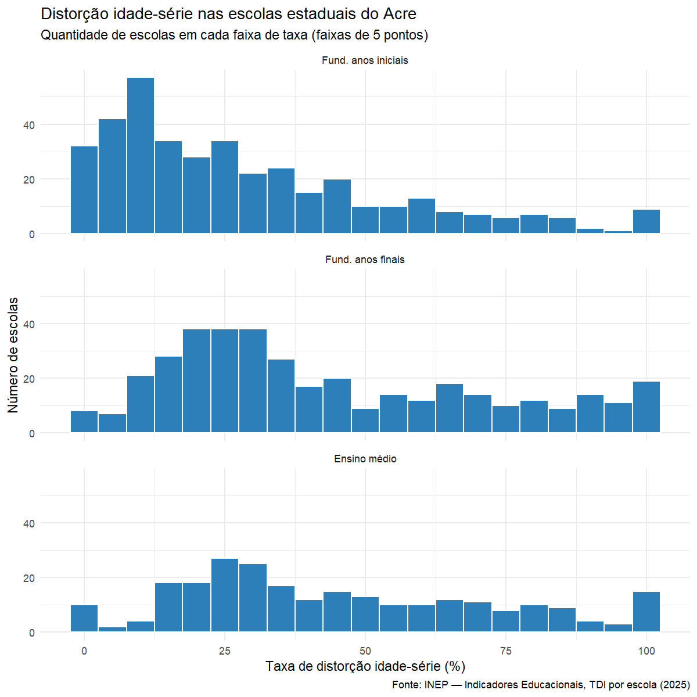
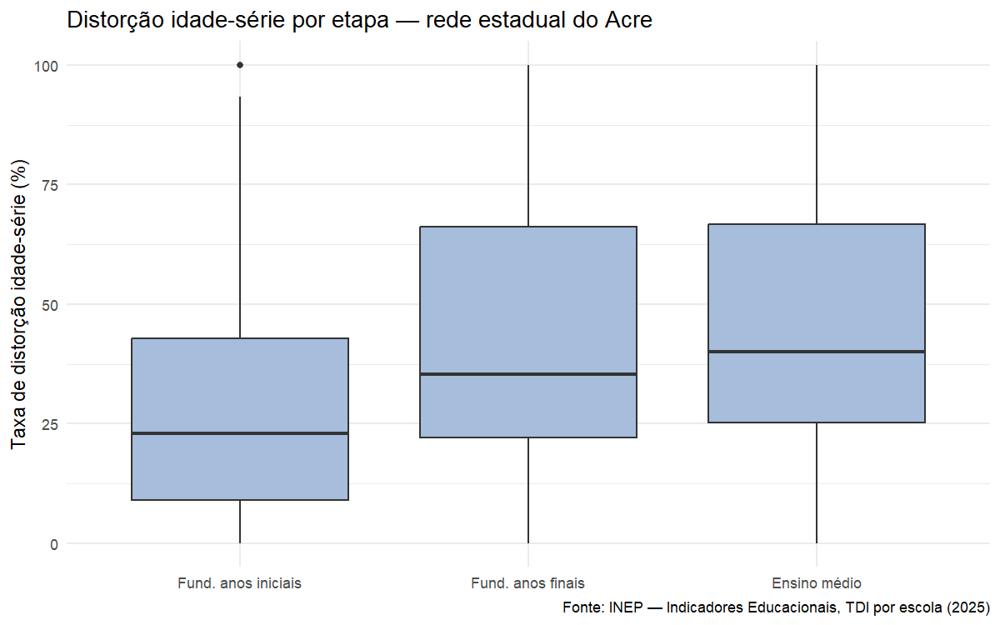
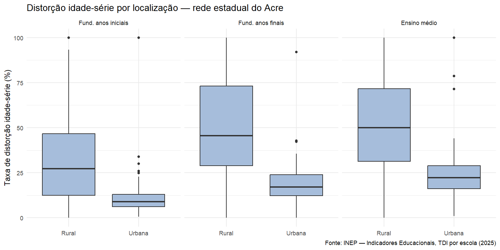
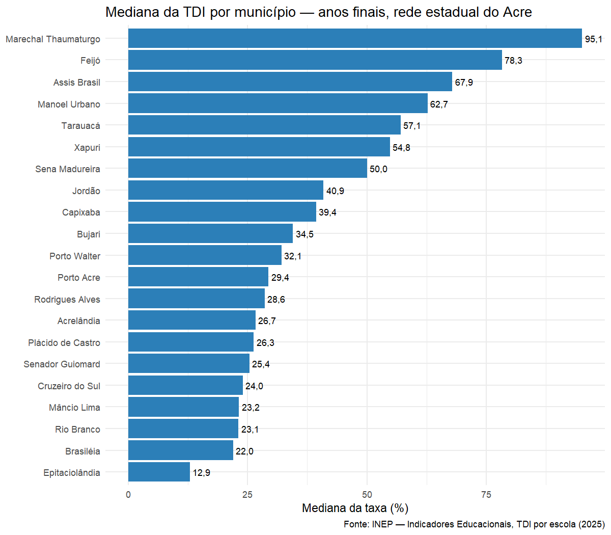

# Distorção idade-série nas escolas da rede estadual do Acre

Análise descritiva, em R, da taxa de distorção idade-série (TDI) das escolas da rede estadual do Acre, usando dados abertos do INEP.

> Projeto do Projeto Integrador — Tecnologia em Ciência de Dados, Gran Faculdade.

## Problema investigado

Um estudante está em **distorção idade-série** quando tem dois anos ou mais de idade acima do esperado para a série que cursa. Taxas altas indicam reprovação, abandono e retorno à escola, e ajudam a gestão pública a decidir onde concentrar ações de recomposição da aprendizagem e correção de fluxo.

**Pergunta:** como a distorção idade-série se distribui entre as escolas da rede estadual do Acre, e como ela varia entre etapas de ensino, escolas urbanas e rurais e municípios?

## Objetivos

- Calcular medidas de posição e dispersão da TDI por etapa (anos iniciais, anos finais e ensino médio).
- Comparar escolas urbanas e rurais.
- Identificar os municípios com maior distorção nos anos finais do fundamental.
- Apresentar os resultados em gráficos simples e interpretá-los.

## Fonte dos dados

INEP — Indicadores Educacionais, **Taxa de Distorção Idade-Série por Escola**, ano de referência **2025**.
Página oficial: https://www.gov.br/inep/pt-br/acesso-a-informacao/dados-abertos/indicadores-educacionais/taxas-de-distorcao-idade-serie

Os dados são públicos e agregados por escola. Não há informação sobre estudantes individuais.

## Ferramentas

- R e RStudio
- Pacotes: `readxl`, `dplyr`, `tidyr`, `ggplot2`

## Etapas realizadas

1. Leitura da planilha do INEP.
2. Filtro: escolas do Acre da rede estadual.
3. Limpeza: nomes de coluna padronizados e conversão das taxas para número (`--` = sem dado).
4. Reorganização da tabela (uma linha por escola e etapa).
5. Cálculo de média, mediana, desvio-padrão, coeficiente de variação, quartis e assimetria.
6. Gráficos: histogramas, boxplots e barras por município.

## Principais resultados

A base tem **578 escolas estaduais** no Acre em 2025. Nem todas oferecem as três etapas, por isso o número de escolas muda em cada linha.

| Etapa               | Escolas | Média (%) | Mediana (%) | Q1–Q3 (%)   | Desvio-padrão | CV (%) | Assimetria |
| ------------------- | ------- | --------- | ----------- | ----------- | ------------- | ------ | ---------- |
| Fund. anos iniciais | 387     | 29,1      | 22,9        | 9,1 – 42,9  | 25,0          | 86     | 1,0        |
| Fund. anos finais   | 384     | 43,9      | 35,4        | 22,0 – 66,1 | 28,0          | 64     | 0,6        |
| Ensino médio        | 253     | 45,6      | 40,0        | 25,3 – 66,7 | 27,1          | 59     | 0,4        |

**Mediana por localização (%):**

| Etapa               | Rural | Urbana | Escolas rurais |
| ------------------- | ----- | ------ | -------------- |
| Fund. anos iniciais | 27,3  | 8,9    | 315 de 387     |
| Fund. anos finais   | 45,6  | 17,1   | 293 de 384     |
| Ensino médio        | 50,0  | 22,2   | 192 de 253     |

**Interpretação:**

- **A distorção cresce ao longo da trajetória escolar.** A mediana sobe de 22,9% nos anos iniciais para 35,4% nos anos finais e 40,0% no ensino médio. O maior salto (12,5 pontos) ocorre na passagem para os anos finais.
- **Algumas escolas puxam a média para cima.** Em todas as etapas a média supera a mediana. A assimetria é mais forte nos anos iniciais (1,0): a maioria das escolas tem taxas baixas, mas um grupo menor chega a valores muito altos.
- **As escolas são muito desiguais entre si.** Nos anos finais, metade das escolas fica entre 22% e 66%, uma faixa de 44 pontos. Os coeficientes de variação, entre 59% e 86%, confirmam a dispersão alta. Os histogramas mostram ainda escolas com 0% e com 100% de distorção.
- **A localização é a diferença mais marcante.** A mediana das escolas rurais é cerca de 2 a 3 vezes a das urbanas em todas as etapas (nos anos finais, 45,6% contra 17,1%). As escolas rurais também são a grande maioria da rede e variam muito mais entre si.
- **Os municípios do interior concentram as maiores taxas.** Nos anos finais, Feijó (78,3%, 50 escolas), Tarauacá (57,1%, 45 escolas) e Sena Madureira (50,0%, 42 escolas) combinam medianas altas com muitas escolas. Rio Branco (23,1%) e Cruzeiro do Sul (24,0%) estão entre as menores medianas.

### Gráficos









## Conclusões

A distorção idade-série na rede estadual do Acre é alta e desigual. Ela se acumula ao longo da escolarização e se concentra nas escolas rurais e em municípios do interior. Para a gestão, os dados sugerem priorizar ações de correção de fluxo nas escolas rurais e na transição para os anos finais do fundamental, com atenção especial a Feijó, Tarauacá e Sena Madureira, onde taxas altas atingem muitas escolas. Como a análise é descritiva, o passo seguinte seria investigar as causas, por exemplo cruzando a TDI com taxas de reprovação e abandono.

## Limitações

- Análise **descritiva**: mostra como os dados se distribuem, mas não explica as causas da distorção.
- Cada escola pesa igual na média, independentemente do número de matrículas. Por isso, os valores não equivalem à taxa oficial do estado, calculada sobre o total de alunos.
- Escolas com poucos alunos tendem a ter taxas extremas (0% ou 100%), porque cada aluno pesa muito no percentual.
- Municípios com poucas escolas estaduais (Marechal Thaumaturgo, Manoel Urbano, Capixaba, Acrelândia, Brasiléia, Epitaciolândia e Jordão, com 3 a 5 escolas) têm medianas instáveis e devem ser lidos com cautela.
- Escolas sem a etapa ou sem dado divulgado (`--`) ficaram fora do cálculo daquela etapa.
- O recorte é só a rede estadual: os resultados não valem para as redes municipal, federal e privada.
- Os dados retratam um único ano.

## Como reproduzir

1. Instale o [R](https://cran.r-project.org/) e o [RStudio](https://posit.co/download/rstudio-desktop/).
2. Baixe este repositório (botão **Code → Download ZIP**) e descompacte.
3. Na página do INEP (link acima), baixe o arquivo **Escolas** de 2025, descompacte e coloque o `.xlsx` na pasta `dados/` (o script lê a primeira planilha `.xlsx` que encontrar ali).
4. Abra `analise_distorcao_acre.R` no RStudio, vá em **Session → Set Working Directory → To Source File Location** e rode o script.
5. Os gráficos são salvos em `graficos/` e as tabelas em `resultados/`.

## Estrutura do repositório

```
├── analise_distorcao_acre.R    # script comentado, passo a passo
├── dados/
│   └── tdi_escolas_estaduais_acre.csv   # escolas estaduais do Acre (gerada pelo script)
├── resultados/                 # tabelas de medidas descritivas (.csv)
├── graficos/                   # gráficos (.png)
└── README.md
```

## Autor

Eduardo Leandro Maia Moura — estudante de Tecnologia em Ciência de Dados (Gran Faculdade).
[LinkedIn](linkedin.com/in/eduardolmmoura) · [GitHub](https://github.com/ProbusAlmagestus)
